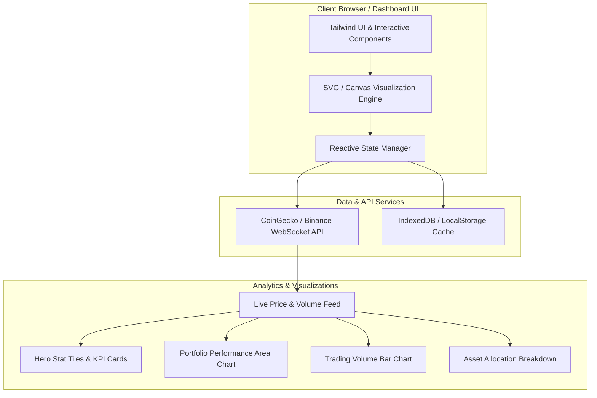
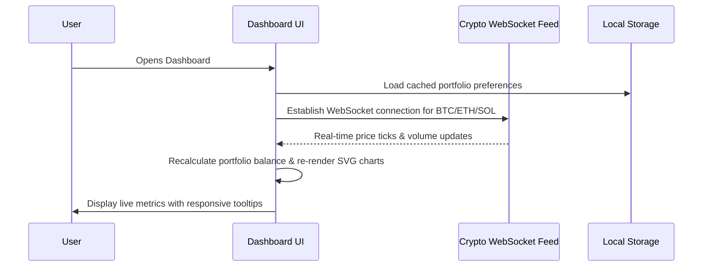

# Crypto Tracker Dashboard — Architecture & System Design

## Overview
A high-performance real-time cryptocurrency portfolio tracker and analytics dashboard built with modern web technologies, adhering to strict WCAG 2.2 accessibility standards and professional data visualization guidelines.

---

## System Architecture Diagram

---

## Data Flow & Sequence

---

## Tech Stack
- **Frontend**: HTML5, Tailwind CSS, Vanilla JavaScript (ES6+), SVG Charts
- **Data Visualization**: Custom accessible SVG charts with hover crosshairs and tooltips
- **Deployment**: Vercel / Netlify / GitHub Pages
- **Testing**: Playwright E2E & unit tests
